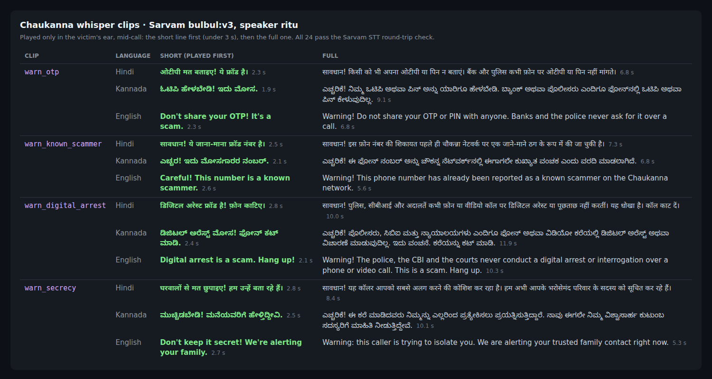

# tts_asset_generator

Pre-generates Chaukanna's scam-warning whispers with Sarvam AI TTS (`bulbul:v3`,
speaker `ritu`). The Flutter app plays them from local assets mid-call, so a
warning needs no network and adds no latency.



4 warnings x 3 languages (`hi`, `kn`, `en`) x 2 variants = 24 WAVs (24 kHz mono
16-bit) in `output_assets/`, plus `manifest.json`:

| file | variant | length |
|---|---|---|
| `{clip}_short_{lang}.wav` | short: what a native speaker would blurt out, played first | 1.9–2.8 s (must be < 3 s) |
| `{clip}_{lang}.wav` | full explanation | 5.3–12.0 s |

`clip` is one of `warn_otp`, `warn_digital_arrest`, `warn_secrecy` or `warn_known_scammer`.
Every clip is trimmed to 20 ms of lead-in and 60 ms of tail, then normalised to
-16 dBFS speech RMS, with peaks kept at or below -1 dBFS.

## Regenerate and ship into the app

```bash
cp .env.example .env                 # once: add SARVAM_API_KEY
python3 generate.py --out ~/Projects/chaukanna_app/assets/audio
python3 generate.py --verify --out ~/Projects/chaukanna_app/assets/audio
python3 generate.py --check          # optional: Sarvam STT round trip
```

`--out` copies the clips and `manifest.json` into the app's `assets/audio/`. Clips
that an earlier run put there and that no longer exist are removed; other files are
left alone. Because that directory sits in a Flutter project, `--out` also writes
`lib/generated/whisper_clips.dart` (already `dart format`-clean). The app's
`pubspec.yaml` must list `assets/audio/`.

To change a line, edit `SCRIPTS` in `generate.py` and run the ship command again.
Only that clip is re-synthesized.

## How rebuilds are decided

Each clip's manifest entry stores three values:

- **`script_hash`:** a hash of the exact TTS request, meaning the spoken text,
  language, model, speaker, pace and sample rate.
- **`post_hash`:** a hash of the `POST` trim and loudness settings.
- **`sha256`:** a hash of the file on disk.

A clip is rebuilt when any of these three no longer matches. `--verify`, which
runs offline, reports a mismatch as `STALE`, `STALE-POST` or `CHANGED`. It also
reports `MISSING`, `TOO LONG` (a short clip of 3 s or more) and a Dart file that is
out of sync. A script edit can no longer leave old audio behind while verify still
says OK.

Raw Sarvam responses are cached in `.cache/tts/<script_hash>.wav` (gitignored). That
makes changing `POST`, re-targeting `--out` or rebuilding a hand-edited file free.
`--force` ignores the cache. If you change the processing code itself, also change
a `POST` value or run with `--force`.

## Checking the audio without a native speaker

`--check` sends each clip through Sarvam STT (`saarika:v2.5`) and compares the
transcript with the script. Results are cached in `stt_check.json` by file hash, so
only changed clips cost an API call; `--recheck` ignores that cache. The rules
differ by language:

- **English:** must match word for word, after punctuation, contractions and known
  spellings of "Chaukanna" are normalised. This is what caught "Warning" being heard
  as "Warming".
- **Hindi and Kannada:** need a character similarity of at least 0.90. Nukta, ZWJ,
  chandrabindu and OTP/PIN written in Latin script are ignored.

The latest run is 24/24.

`PRONOUNCE` changes what TTS is sent without changing the caption. English
"Chaukanna" was read as "Chokanna", so TTS is now sent "Chau-kanna", and STT hears
"Chaukhanna", the same as it hears for the Devanagari spelling.

To try a wording before committing to it, run
`python3 generate.py --try "text" --lang kn [--pace 0.95]`. It prints the measured
duration and what STT heard, and saves the WAV under `.cache/try/`. Add
`--only 'warn_otp_short_*'` to build or check a subset.

## Using it from Flutter

```dart
import 'generated/whisper_clips.dart';

final short = whisperClip('warn_otp', lang);                  // falls back to 'en'
final full = whisperClip('warn_otp', lang, variant: 'full');
// short?.asset, short?.text (caption), short?.durationMs
whisperClipsForLang(lang);  // all 8 clips for a language, e.g. to preload at call start
```

## Tests

```bash
python3 -m unittest discover -s tests -v
```

The tests cover hashing and rebuild decisions, trimming and loudness, manifest and
Dart generation (including a `dart format` no-op check when `dart` is installed),
mirroring and pruning, and STT scoring. They run offline and make no Sarvam calls.
One test also fails if `output_assets/` is stale relative to `SCRIPTS`.

The code uses only the Python standard library and needs Python 3.9 or later.
