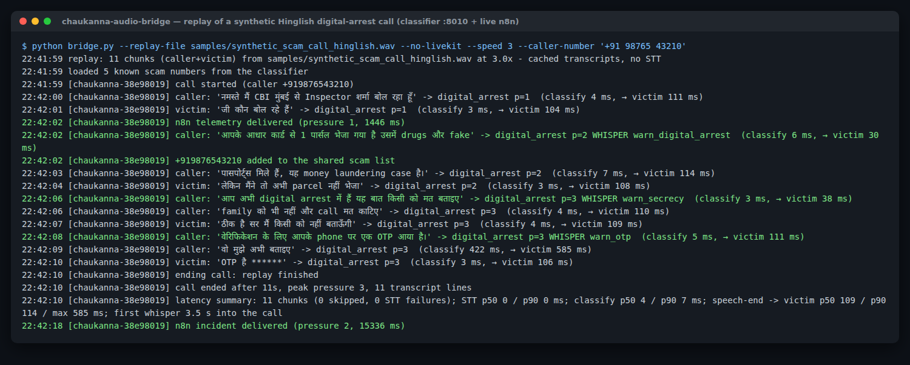
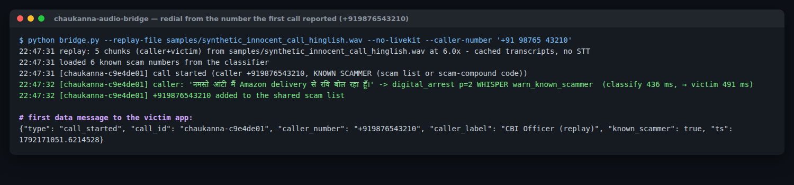
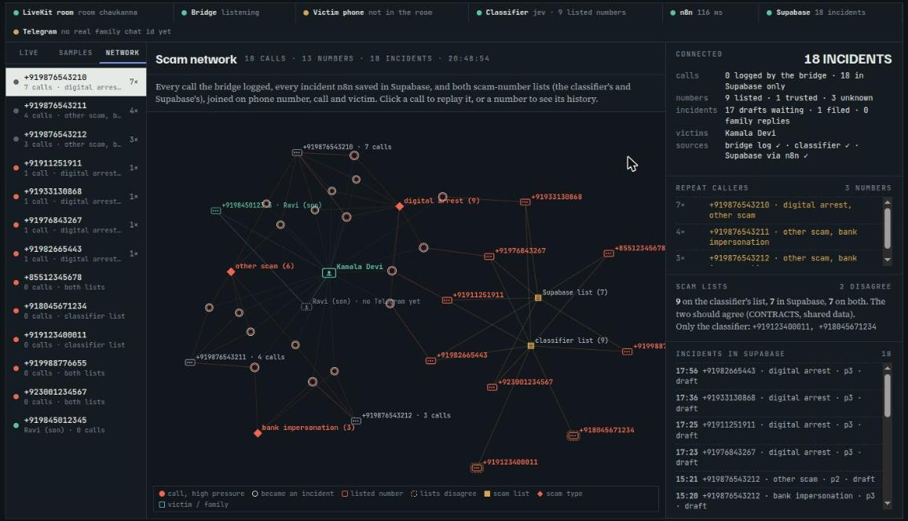

# Chaukanna audio bridge

Lean daemon on the raw `livekit` rtc SDK (no livekit-agents). Joins a LiveKit room as the hidden observer
`chaukanna-guardian`, turns each participant's audio into 4 s / 16 kHz / mono WAV chunks in memory, and runs

```
audio -> Sarvam STT -> POST /classify (mock fallback) -+-> victim-only data message (transcript, verdict, whisper flag)
                                                       +-> n8n events: telemetry / incident / escalation / call_ended
```




## Run

```bash
python -m venv .venv && .venv/bin/pip install -r requirements.txt
cp .env.example .env            # LiveKit URL/key/secret, SARVAM_API_KEY, N8N_WEBHOOK_URL
.venv/bin/python bridge.py      # live mode; reconnects with backoff
```

`N8N_WEBHOOK_URL` must be set, or no n8n event is ever sent (the bridge logs a warning at start).
Message formats for every hop are in `CONTRACTS.md`.

- Identity convention: participant `victim` (override with `VICTIM_IDENTITY`) is the victim; every other non-guardian participant is the caller.
- Each call gets its own `call_id` (`<room>-<uuid8>`): it starts when a caller joins and ends when the caller or the victim leaves (a dropped connection gets `CALL_END_GRACE_SECONDS` to come back). The classifier is reset at call end.
- Data messages (topic `chaukanna.verdict`, victim only): `call_started`, `verdict` (with the bridge's whisper decision), `incident` (n8n's reply), `heartbeat` every 5 s, `call_ended`. A victim who joins mid-call gets a snapshot.
- Caller number comes from participant metadata `{"phone": "..."}` (the dialer sets it), falling back to the display name.
- Shared scam list: at startup the bridge loads the classifier's `GET /scam_numbers`, and when a call becomes an
  incident it POSTs the caller to `/scam_numbers` (`REPORT_SCAMMERS=1`). n8n writes the same number to Supabase,
  so a redial is flagged in `call_started` and whispers `warn_known_scammer` on its first chunk.
- Silent chunks (RMS < `SILENCE_RMS`) are not sent to STT. If STT falls behind, the oldest queued chunk is dropped so the bridge stays live.

## Replay (venue Wi-Fi fallback)

```bash
.venv/bin/python bridge.py --replay-file samples/synthetic_scam_call_hinglish.wav   # real-time, still publishes to LiveKit + n8n
.venv/bin/python bridge.py --replay-file call.wav --no-livekit           # verdict JSON to stdout only
.venv/bin/python bridge.py --replay-file call.wav --mock-stt --speed 8   # offline wiring test, 8x faster
```

Same STT -> classifier -> data channel -> n8n code path as live. If LiveKit is unreachable, replay degrades to stdout.
`samples/` holds SYNTHETIC Sarvam-TTS calls (stereo, caller left / victim right) with cached transcripts; record a rehearsal with `--record-dir` for a real one.

## Scammer dialer

```bash
.venv/bin/python token_server.py     # open http://localhost:8787
```

`scammer_dialer.html` is served from the token server, which mints a `caller-*` token with the typed phone number in metadata.
Set `VICTIM_TOKEN_KEY` to also serve `GET /victim-token?key=<key>` → `{"token","url"}`, so the app can be built with
`--dart-define=LIVEKIT_TOKEN_URL=https://<host>/victim-token?key=<key>` instead of a baked-in token. It is off by
default because a victim token can read the guardian's data messages. `python tokens.py victim --ttl 48h` still works.
Expose it with `hoist` for teammates on other laptops (mic access needs HTTPS). Without the server, paste a LiveKit URL + JWT under "Advanced".

## Guardian console

```bash
.venv/bin/python token_server.py     # open http://localhost:8787/console/
```




The assay replay UI (TigerGraph fraud investigator) re-cast for calls: a force graph that grows chunk by chunk
(caller, victim, the hidden guardian, every utterance coloured by pressure, the classifier signals it raised, the
scam type, each whisper, the n8n incident and what n8n did), a pressure needle (0 calm → 3 critical, n8n at 2),
the transcript, the classifier and n8n calls in order, and the final stamp with the 1930 draft. "Tell me the story"
is a 90-second narrated walkthrough for judges.

- **Live:** the bridge appends every message it sends the victim, plus each n8n event and reply, to
  `calls/<call_id>.jsonl` (`calllog.py`; `CALL_LOG_DIR` moves it, `CALL_LOG_DIR=` turns it off). The console polls
  that folder through the token server and jumps to a new call as it starts, then follows it as it happens.
  Heartbeats and late-joiner snapshots are not logged; victim OTP digits are already masked.
- **Samples:** `console/samples/` holds four calls replayed through the real classifier (Jev) with n8n off
  (`N8N_WEBHOOK_URL= REPORT_SCAMMERS=0 CALL_LOG_DIR=console/samples bridge.py --no-livekit --replay-file ... --call-id sample-...`),
  so the page works with no bridge running; it is also a static folder you can host anywhere.
- **Network** (third rail tab): every call joined into one graph, the way assay joined cards through a shared
  device. Caller numbers → calls → victim, calls → scam type, numbers → the classifier's scam list and Supabase's
  `scam_numbers` (a dashed ring where the two lists disagree), and the family contact who gets the Telegram alert.
  Calls come from the bridge's log and from Supabase `incident_evidence` (so incidents from before logging show up
  too); click a call to replay it, or a number to see its history. Supabase is read through the n8n feed workflow
  (CONTRACTS §7): set `CONSOLE_FEED_KEY` in `.env` (the same value as the workflow's header-auth credential).
- **Status strip** above the bench: LiveKit room, bridge, victim phone, classifier, n8n, Supabase, Telegram, checked
  every 10 s (`/console/api/health`). The bridge's heartbeat file `calls/_bridge.json` says whether it is in the room.
- The call API (`/console/api/...`) carries transcripts, so it answers only on this machine (loopback, which includes
  `adb reverse`) unless `?key=<CONSOLE_KEY>` matches, and it sends no CORS header. The page and samples are public.

## Tests

`python -m unittest discover -s tests` covers chunking, WAV encoding, resampling, the fast/slow paths with cooldown, the classifier fallback, and the console's call log and endpoints.
The live LiveKit path (track subscribe -> AudioStream) has not been run against a real server here.
