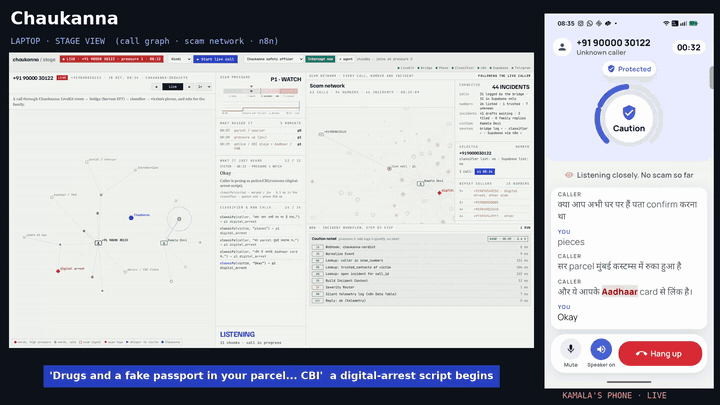
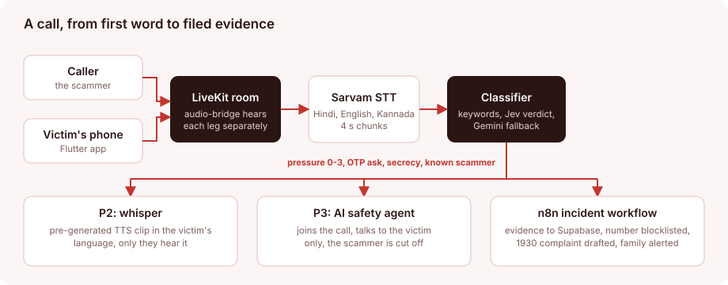
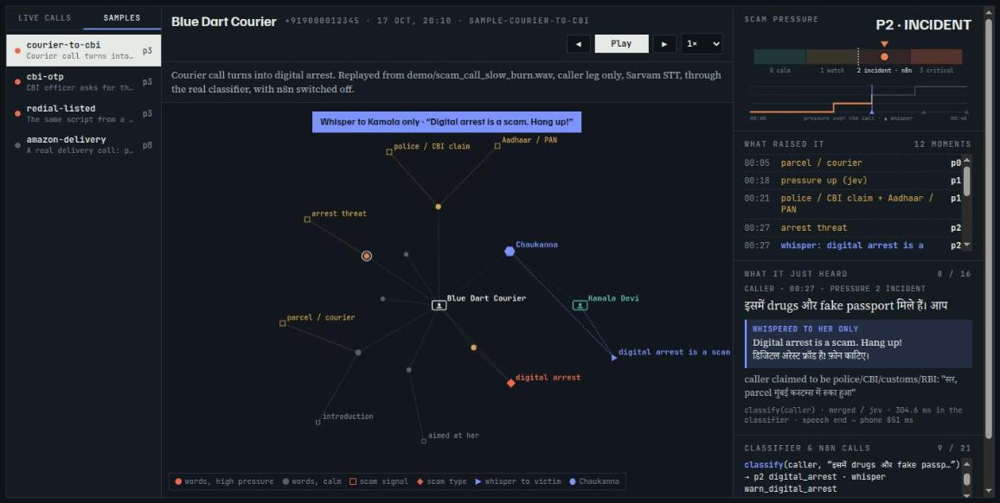

<div align="center">

# Chaukanna (चौकन्ना)
### A scam-call guardian that listens to the call with you.

    

**[▶ Watch the 2-minute demo](https://youtu.be/8vpouj2xdso)**



<sub>A real run on the live stack, not a mock-up. The scammer is a robot playing a recorded Hindi script into the call.</sub>

</div>

When a caller starts a digital-arrest, KYC or OTP script, Chaukanna **whispers a warning only the victim hears, in their language**. On a critical call an AI safety agent cuts the scammer off, and an n8n workflow saves the evidence, blocklists the number and drafts the 1930 cybercrime complaint for a human to approve.

| 28 / 28 | 0 / 19 | ~0.3 s |
|:---:|:---:|:---:|
| scam calls caught, right type named | false alarms on ordinary calls | per verdict (keyword fast path under 5 ms) |

## Why it exists

Digital-arrest scams run on panic. The right response is a checklist (hang up, call the bank, call 1930, keep evidence, warn the family) and under panic almost nobody gets through it in time. The victims are mostly elders and first-time digital users, and block-lists miss new numbers. Chaukanna does the checklist for them, live.

## How it works



| Screen | |
|---|---|
|  |  |

## Decisions worth knowing

- **Two-speed classifier.** A keyword path answers in under 5 ms so the first whisper is never late. A typed verdict from Jev (about 0.3 s) refines it, and Gemini is the fallback.
- **Whispers are pre-generated.** The Hindi, English and Kannada clips are rendered ahead of time with Sarvam TTS, so a warning plays instantly with no synthesis on the call path.
- **False alarms are a feature to protect.** A delivery agent asking for a gas-delivery code, or your son asking for an OTP from his saved number, stays quiet. A bank OTP request, a threat or a secrecy demand escalates.
- **Repeat callers get caught earlier.** Once a number is reported it lands on a shared list, so the next call is flagged in its first sentence.
- **A human files the complaint.** The 1930 complaint is drafted, never submitted automatically.

## Run it

Needs a LiveKit server, a Sarvam key, a Gemini key (Jev optional), plus n8n and Supabase for the response side. Copy each `.env.example` to `.env`; no keys are committed.

```bash
cd classifier/classifier_service && pip install -r requirements.txt && python main.py   # :8010
cd audio-bridge && pip install -r requirements.txt && demo/stage.sh up                  # token server, bridge, stage view
demo/stage.sh run                                                                       # the four scripted calls
```

## Honest limits

- Demo calls are app-to-app over LiveKit. Android blocks third-party apps from recording the other side of a normal SIM call, so real numbers would need call forwarding into a SIP trunk (Exotel, Plivo or Twilio into LiveKit SIP). That is the next step.
- The Telegram family alert works, but the demo has no real family chat id configured.

## Repository

| Folder | What it is |
|---|---|
| [`app/`](app/) | Flutter Android app for the victim |
| [`audio-bridge/`](audio-bridge/) | LiveKit guardian, Sarvam STT, stage console, scam-caller robots, interceptor agent |
| [`classifier/`](classifier/) | FastAPI verdict service, scam and trusted lists, eval set |
| [`incident-responder/`](incident-responder/) | n8n workflows and the Supabase schema |
| [`tts-assets/`](tts-assets/) | Whisper clip generator |
| [`deck/`](deck/) · [`media/`](media/) | Pitch deck, demo video and stills |

Full write-up, with every component's layout and setup: [`docs/DETAILS.md`](docs/DETAILS.md).

Built at Hack Sprint 2026 (MIT Bengaluru, 17 to 18 Oct) by Nikhil, Shreyas, Koustav and Deekshitha (NMIT).
