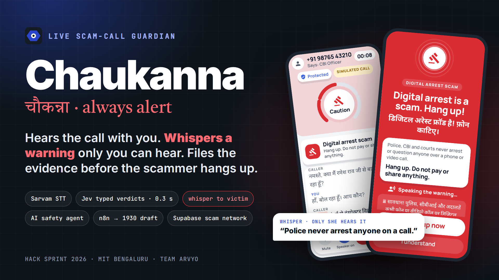
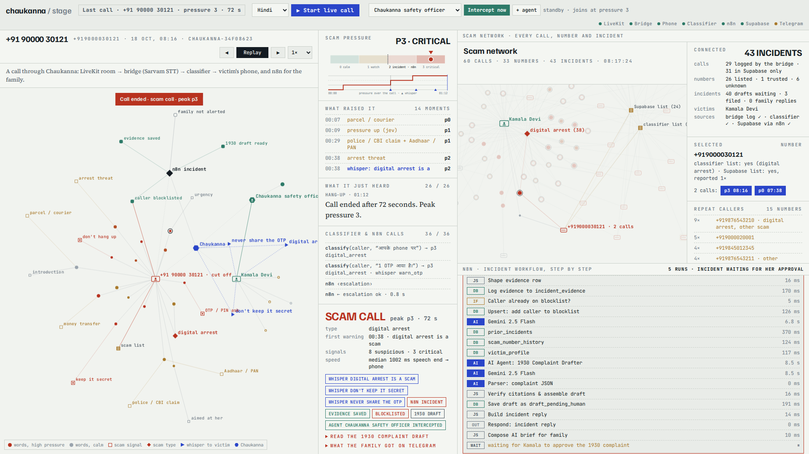

# Chaukanna (चौकन्ना): live scam-call guardian



**Chaukanna listens to the call with you. When a caller starts a digital-arrest, KYC or OTP script, it whispers a
warning that only you can hear, in your language. On a critical call an AI safety agent cuts the scammer off.
n8n handles the response: evidence goes to Supabase, the number goes on a shared scam list, and Gemini drafts a
1930 cybercrime complaint for you to approve.**

Built at Hack Sprint 2026 (MIT Bengaluru, 17–18 Oct) by Nikhil, Shreyas, Koustav and Deekshitha (NMIT).

▶ **Demo video:** [`media/chaukanna-demo.mp4`](media/chaukanna-demo.mp4) (1 min 55 s). It is a real run on the
live stack, in real time. A robot caller plays a recorded Hindi digital-arrest script into the call, and
everything after that is live: Sarvam STT, the classifier, the whispers, the interceptor agent and n8n.



## The problem

Digital-arrest scams run on panic. A fake courier, police or CBI caller keeps the victim on the line, tells
them to keep it secret, and asks for OTPs and transfers. The right response is a checklist: hang up, call the
bank, call 1930, keep evidence, warn the family. Under panic almost nobody gets through it in time, and the
victims are mostly elders and first-time digital users. Static block-lists miss new numbers, and the scripts
keep changing language.

## How it works

```
 Caller ─┐                                   ┌─ Victim's phone (Flutter app)
         └──────── LiveKit room ─────────────┘      ▲ whisper + alarm (only she hears it)
                        │                            │
              audio-bridge (hears each leg separately)
                        │ 4 s chunks
                  Sarvam STT (hi / en / kn)
                        │
        classifier: keyword fast path (<5 ms) + Jev typed verdict (~0.3 s), Gemini fallback
          {scam_type, pressure 0–3, asks_otp_or_pin, demands_secrecy, known_scammer}
                        │
     ┌──────────────────┼──────────────────────────────┐
  P2: whisper      P3: AI safety agent joins,     n8n incident workflow
  (Sarvam TTS,     talks to the victim only,      evidence → Supabase, caller blocklisted,
  pre-generated)   caller is cut off              Gemini drafts the 1930 complaint (she approves),
                                                  family alert on Telegram
```

| Step | What happens | Tech |
|---|---|---|
| Listen | The call runs through a LiveKit room. The bridge hears caller and victim on separate legs | Flutter, LiveKit (WebRTC), Python |
| Understand | Streaming Indic STT, then a typed verdict per chunk | Sarvam STT, keywords, Jev (TypeSafe), Gemini fallback |
| Intervene | A whisper in the victim's language at P2. At P3 an AI agent takes over the call | Sarvam TTS (bulbul:v3), Gemini 2.5 Flash |
| Respond | Evidence log, shared scam-number list, complaint draft, family alert | n8n (self-hosted), Supabase, Telegram |
| Watch | One stage view follows the call graph, the scam network and n8n step by step | `audio-bridge/console/stage.html` |

**What it gets right:**

- **Few false alarms.** A delivery agent asking for a gas-delivery code, or your son asking for an OTP from his
  saved number, stays at P1 with no whisper. A bank OTP, a threat, a secrecy demand or a "galti se bheja"
  excuse escalates.
- **Repeat callers.** Once a number is reported it is on the shared list, so the scammer's next call is
  flagged in its first sentence.
- **OTP SMS context.** The app reads only the purpose of an incoming OTP SMS (payment, bank login, SIM, …)
  so the guardian knows what the OTP would unlock.
- **Eval:** Jev caught 28 of 28 scam calls and named the right type in all 28, with 0 false alarms on 19
  ordinary calls (`classifier/` eval set).

## Repository layout

Each folder was its own repo during the hackathon. They were merged here with their full git history.

| Folder | What it is | Original repo |
|---|---|---|
| [`app/`](app/) | Flutter Android app for the victim: live risk, whispers, alarm, post-call complaint | `chaukanna_app` |
| [`audio-bridge/`](audio-bridge/) | LiveKit guardian, Sarvam STT, call logs, stage console, robot and AI scam callers, interceptor agent | `chaukanna-audio-bridge` |
| [`classifier/`](classifier/) | FastAPI verdict service (keywords + Jev + Gemini), scam and trusted lists, eval set | `chaukanna-classifier` |
| [`incident-responder/`](incident-responder/) | n8n workflows (incident response, console feed), Supabase schema and seeds | `chaukanna-incident-responder` |
| [`tts-assets/`](tts-assets/) | Generates the whisper clips with Sarvam TTS in hi / en / kn | `tts_asset_generator` |
| [`deck/`](deck/) | Pitch deck (PDF + PPTX), slide images, the build plan | — |
| [`media/`](media/) | Demo video, cover image, stage screenshot | — |

Every component follows the same message formats and ports, defined in `CONTRACTS.md` (a copy is in each
folder).

## Run it

You need a LiveKit server, a Sarvam API key, a Gemini key (and optionally a TypeSafe/Jev key), plus n8n and
Supabase for the response side. Each folder's README covers its own setup. Copy each `.env.example` to `.env`;
keys are never committed.

```bash
cd classifier/classifier_service && pip install -r requirements.txt && python main.py   # :8010
cd audio-bridge  && pip install -r requirements.txt && demo/stage.sh up    # token server, bridge, stage view
demo/stage.sh run                 # the four scripted stage calls (delivery, scam, son, redial)
demo/stage.sh live hi             # or talk to a live AI scammer yourself
```

The n8n workflow JSON is in `incident-responder/incident_responder/`; import it and attach your Supabase and
Telegram credentials. The app builds with `flutter build apk` plus the `--dart-define`s listed in `app/README.md`.

## Honest limits

- The demo calls are app-to-app over LiveKit. Android blocks third-party apps from recording the other side of
  an ordinary SIM call (the app's mic is marked `silenced` during a call). Real phone numbers would need call
  forwarding into a SIP trunk (Exotel / Plivo / Twilio → LiveKit SIP), which is a next step.
- The 1930 complaint is drafted, never filed automatically. A human confirms it.
- Telegram family alerts work, but the demo has no real family chat id configured.
